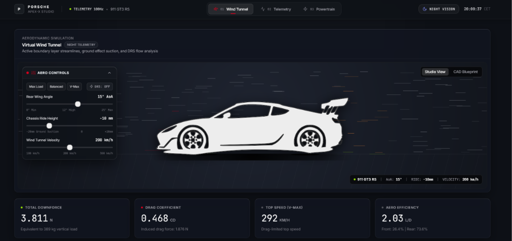
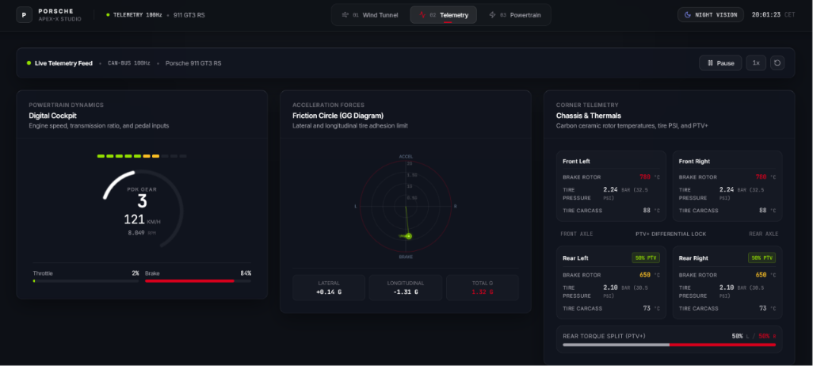

# Porsche Apex-X Studio // Aerodynamic Engineering & Telemetry Lab

[](https://xppet.github.io/porsche-apex-x-lab/)
[](https://reactjs.org/)
[](https://vitejs.dev/)
[](https://tailwindcss.com/)
[](https://www.chartjs.org/)

An interactive motorsport engineering workbench and telemetry command center modeled around the performance physics of Porsche Motorsport—contrasting the naturally aspirated, high-downforce **Porsche 911 GT3 RS (992)** against the all-electric, twin-motor **Porsche Taycan Turbo GT**.

**[Launch Live Application](https://xppet.github.io/porsche-apex-x-lab/)**

---

## Interactive Walkthrough & Media

### Virtual Wind Tunnel Simulation (Live Airflow & DRS Physics)

https://github.com/user-attachments/assets/wind-tunnel-demo.mp4

*(Note: Ensure `screenshots/wind-tunnel-demo.mp4` is pushed to your repository, or drag-and-drop the `.mp4` file directly into the GitHub web editor for `README.md` to generate an auto-playing CDN video embed.)*

---

### Module Interface Previews

| Virtual Wind Tunnel & Aero Polar | Live Telemetry & Friction Circle | Powertrain & 1/4-Mile Drag Simulator |
| :---: | :---: | :---: |
|  |  |  |

---

## Core Engineering Modules

### 1. Virtual Wind Tunnel & Aerodynamics Workbench
A real-time aerodynamic testing environment equipped with a floating glassmorphic HUD control dock (`Aero Controls`) for zero-scroll parameter tuning:
* **Quadratic Downforce & Drag Modeling:** Calculates vertical aerodynamic load ($F_z$ in Newtons and kg-equivalent) as a function of velocity squared ($v^2$), swan-neck rear wing angle of attack ($0^\circ\text{–}25^\circ$), and chassis ride height ($-20\text{ mm}$ to $+20\text{ mm}$).
* **Active DRS (Drag Reduction System):** Flattens the upper rear wing element on demand, reducing the drag coefficient ($C_d$) by ~30% and dynamically recalculating drag-limited top speed ($V_{\max}$).
* **Dynamic Axle Balance & Polar Curves:** Visualizes Front vs. Rear center-of-pressure distribution and plots real-time Angle-of-Attack and Velocity Sweep polar curves via Chart.js.
* **Vector Airflow Streamlines:** Color-coded streamline vectors illustrating front radiator stagnation (Carmine Red), underbody Venturi ground-effect suction (Acid Green), and wake turbulence.

### 2. Live Telemetry & G-Force Command Hub
Emulates a trackside pit-wall telemetry monitor (inspired by Porsche Piwis / Cosworth telemetry systems) simulating a hot lap around the **20.832 km Nürburgring Nordschleife**:
* **Friction Circle (Kamm's Circle of Adhesion):** Plots instantaneous lateral cornering forces (up to $\pm 1.8\text{G}$) against longitudinal braking and acceleration loads to analyze trail-braking efficiency.
* **4-Corner Thermal & Pressure Telemetry:**
  * **PCCB Carbon-Ceramic Rotors ($^\circ\text{C}$):** Monitors rotor temperatures against their optimal $350^\circ\text{C}\text{–}650^\circ\text{C}$ operating window with automated thermal warning states above $680^\circ\text{C}$.
  * **Michelin Pilot Sport Cup 2 R Tires:** Tracks live hot running pressures ($\text{BAR}$ / $\text{PSI}$) and carcass core temperatures ($^\circ\text{C}$).
* **PTV+ Active Differential Split:** Displays real-time rear-axle torque vectoring lock distribution between left and right rear wheels.
* **Multi-Channel Rolling Buffer:** Synchronized time-series traces comparing vehicle velocity ($\text{km/h}$), throttle position ($\%$), and brake pressure ($\%$).

### 3. Powertrain Comparator & 1/4-Mile Drag Strip Simulator
A side-by-side engineering comparison between internal combustion precision and high-voltage electric propulsion:

| Engineering Specification | 911 GT3 RS (992) | Taycan Turbo GT (Attack Mode) |
| :--- | :--- | :--- |
| **Powertrain Architecture** | 4.0L Naturally Aspirated Flat-6 Boxer | Dual Permanent-Magnet Synchronous Motors |
| **Peak Power Output** | 525 PS (386 kW) @ 8,500 RPM | 1,034 PS (760 kW) Attack Mode |
| **Peak Torque** | 465 Nm @ 6,300 RPM | 1,340 Nm Instantaneous |
| **Redline / Max Motor Speed** | 9,000 RPM | 16,000 RPM |
| **Transmission** | 7-Speed Porsche Doppelkupplung (PDK) | 2-Speed Rear + Single-Speed Front |
| **Drivetrain** | Rear-Wheel Drive (RWD) with PTV+ | All-Wheel Drive (AWD) with Torque Vectoring |
| **Curb Weight** | ~1,450 kg (Weissach Package) | ~2,220 kg |

* **Interactive Dyno Curves:** Toggleable horsepower ($\text{PS}$) and torque ($\text{Nm}$) curves contrasting instant EV torque delivery against the linear high-RPM crescendo of the flat-six Boxer.
* **Quarter-Mile (402m) Launch Simulator:** Physics-driven acceleration race allowing real-time adjustments to vehicle curb weight, fuel load, battery State of Charge ($\text{SoC}$), and EV drive modes (*Attack*, *Track*, *Endurance*).

### 4. Dual Vision Modes (Day Studio / Night Telemetry)
* **Day Vision:** High-key silver and off-white aesthetic tailored for aerodynamic flow inspection and design studio reviews.
* **Night Vision:** Low-glare charcoal command center with frosted glass panels and high-contrast Electric Acid Green accents built for trackside telemetry analysis.

---

## Project Architecture

```text
porsche-apex-x-lab/
├── .github/workflows/
│   └── deploy.yml                  # Automated GitHub Pages CI/CD pipeline
├── public/
│   └── assets/                     # Custom Day/Night SVG vehicle profiles
├── screenshots/                    # Demo video (.mp4) & UI captures (.png)
├── src/
│   ├── components/
│   │   ├── StudioHeader.jsx        # Navigation, Vision toggle & live telemetry link status
│   │   ├── StudioWindTunnelCanvas.jsx # SVG vehicle & dynamic airflow vector engine
│   │   ├── StudioAeroHudDock.jsx   # Floating glassmorphic aero parameter controls
│   │   ├── StudioGForceMeter.jsx   # Kamm's Friction Circle G-force plotter
│   │   ├── StudioChassisTelemetry.jsx # 4-corner brake/tire thermals & PTV+ split
│   │   ├── StudioDynoChart.jsx     # Interactive torque & power curve comparator
│   │   └── StudioDragRaceRunner.jsx # 1/4-mile acceleration physics simulator
│   ├── context/
│   │   └── ThemeContext.jsx        # Day & Night vision state management
│   └── App.jsx                     # Main telemetry workspace & module routing
├── index.html
├── package.json
└── vite.config.js                  # Configured with base: '/porsche-apex-x-lab/'
