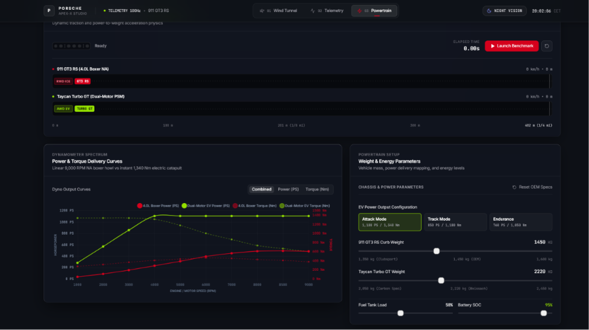

<div align="center">

# PORSCHE APEX-X STUDIO

**Aerodynamic Engineering & Vehicle Telemetry**

*An interactive computational environment for automotive engineering analysis.*

[Live Application](https://xppet.github.io/porsche-apex-x-lab/) · [Source Code](https://github.com/XPPET/porsche-apex-x-lab)

</div>

---

## 01. Overview

Porsche Apex-X Studio is an interactive engineering visualization platform focused on automotive aerodynamics, vehicle dynamics, thermal monitoring, and powertrain performance.

The application provides a computational environment for exploring the relationship between vehicle configuration, aerodynamic forces, tire dynamics, and propulsion characteristics.

Two distinct vehicle architectures are investigated:

- **911 GT3 RS (992)** — Naturally aspirated internal combustion engine, rear-wheel drive, and high-downforce aerodynamic configuration.
- **Taycan Turbo GT** — Dual-motor electric propulsion, all-wheel drive, and electronically controlled torque distribution.

The platform combines mathematical models, interactive parameter controls, and graphical telemetry representations to demonstrate fundamental principles of high-performance vehicle engineering.

## 02. Engineering Modules

### 2.1 Virtual Wind Tunnel

**Computational Aerodynamics & Active Aerodynamic Systems**


The aerodynamic simulation environment models the relationship between vehicle velocity, aerodynamic configuration, and resulting aerodynamic loads.

**Core capabilities**

- **Downforce Modeling** — Quadratic velocity-dependent aerodynamic loading based on \(v^2\).
- **Drag Coefficient Analysis** — Investigation of drag variation with rear wing configuration.
- **Active DRS Simulation** — Modeling of reduced aerodynamic resistance through rear wing adjustment.
- **Ride Height Sensitivity** — Analysis of underbody aerodynamic behavior as a function of chassis clearance.
- **Aerodynamic Balance** — Visualization of front and rear axle aerodynamic load distribution.
- **Polar Curves** — Graphical representation of aerodynamic performance across different operating conditions.
- **Flow Visualization** — SVG-based airflow streamlines illustrating stagnation, underbody flow, and wake regions.

**Simulation parameters**

| Parameter | Range |
|---|---:|
| Rear Wing Angle | 0°–25° |
| Chassis Ride Height | -20 to +20 mm |
| Vehicle Velocity | Dynamic |
| DRS | Active / Inactive |

### 2.2 Vehicle Telemetry & Dynamics

**G-Force Analysis, Thermal Monitoring & Vehicle State**


A simulated telemetry environment representing vehicle operation during a hot lap of the Nürburgring Nordschleife (20.832 km).

**Vehicle dynamics**

- Kamm's Circle and tire friction envelope visualization.
- Lateral acceleration monitoring up to ±1.8 G.
- Longitudinal acceleration and braking analysis.
- Trail-braking visualization.
- Combined longitudinal and lateral tire force representation.

**Thermal monitoring**

- Four-corner brake temperature monitoring.
- Carbon-ceramic brake thermal visualization.
- Tire pressure monitoring in BAR and PSI.
- Tire carcass temperature representation.
- Configurable thermal warning thresholds.

**Telemetry channels**

- Vehicle velocity (km/h).
- Throttle position (%).
- Brake pressure (%).
- Rear differential torque distribution.
- Left/right wheel torque vectoring.

### 2.3 Powertrain Comparator

**Internal Combustion vs. Electric Propulsion**



A comparative engineering environment examining two different propulsion architectures.

**Vehicle specifications**

| Parameter | 911 GT3 RS (992) | Taycan Turbo GT |
|---|---:|---:|
| Propulsion | 4.0L NA Flat-6 | Dual PMSM |
| Peak Power | 525 PS | 1,034 PS* |
| Peak Torque | 465 Nm | 1,340 Nm* |
| Maximum Speed | 9,000 RPM | 16,000 RPM |
| Transmission | 7-Speed PDK | 2-Speed Rear |
| Drivetrain | RWD | AWD |
| Approx. Mass | 1,450 kg | 2,220 kg |

*\*Electric vehicle figures correspond to the specified Attack Mode configuration. Output values are configuration-dependent.*

**Computational tools**

- Dynamic power and torque curves.
- RPM-dependent power delivery analysis.
- Naturally aspirated versus electric torque characteristics.
- Quarter-mile (402 m) acceleration simulation.
- Vehicle mass and configuration adjustments.
- Battery state-of-charge and EV drive-mode parameters.

### 2.4 Dual Visualization Environment

**Day Studio / Night Telemetry**

The application provides two visual operating environments:

| Day Studio | Night Telemetry |
|---|---|
| Light engineering interface | Dark telemetry interface |
| High-contrast technical surfaces | High-contrast telemetry panels |
| Aerodynamic visualization | Vehicle monitoring |
| Design-oriented workflow | Trackside-oriented workflow |

The visualization mode can be changed without interrupting the engineering workspace.

---

## 03. Interactive Demonstration

### Virtual Wind Tunnel — Aerodynamic Flow Simulation

The following recording demonstrates the aerodynamic visualization system, interactive parameter controls, and active DRS simulation.


[Watch the Wind Tunnel Demonstration](https://github.com/XPPET/porsche-apex-x-lab/blob/main/screenshots/bd1d5e5f-9315-4536-9537-8b91d8bb0f5b.mp4)

---

## 04. Technology Stack

| Technology | Application |
|---|---|
| React 18 | Component-based interface architecture |
| Vite 5 | Development and production build system |
| Tailwind CSS 3 | Interface styling and responsive layout |
| Chart.js 4 | Engineering plots and telemetry visualization |
| SVG | Vehicle geometry and aerodynamic flow rendering |
| React Context API | Global visualization state |
| GitHub Actions | Automated deployment |
| GitHub Pages | Static application hosting |

---

## 05. Project Architecture

```text
porsche-apex-x-lab/
├── .github/
│   └── workflows/
│       └── deploy.yml
├── public/
│   └── assets/
├── screenshots/
│   ├── wind-tunnel.png
│   ├── telemetry.png
│   ├── powertrain.png
│   └── bd1d5e5f-9315-4536-9537-8b91d8bb0f5b.mp4
├── src/
│   ├── components/
│   │   ├── StudioHeader.jsx
│   │   ├── StudioWindTunnelCanvas.jsx
│   │   ├── StudioAeroHudDock.jsx
│   │   ├── StudioGForceMeter.jsx
│   │   ├── StudioChassisTelemetry.jsx
│   │   ├── StudioDynoChart.jsx
│   │   └── StudioDragRaceRunner.jsx
│   ├── context/
│   │   └── ThemeContext.jsx
│   └── App.jsx
├── index.html
├── package.json
└── vite.config.js
```

---

## 06. Local Development

**Requirements**

- Node.js (LTS)
- npm
- Git

**Installation**

Clone the repository:

```bash
git clone https://github.com/XPPET/porsche-apex-x-lab.git
cd porsche-apex-x-lab
```

Install dependencies:

```bash
npm install
```

Start the development server:

```bash
npm run dev
```

Generate a production build:

```bash
npm run build
```

The production-ready application is generated in the `dist/` directory.

---

## 07. Deployment

The application is deployed through GitHub Pages using GitHub Actions.

The Vite configuration uses the repository-specific base path:

```javascript
base: '/porsche-apex-x-lab/'
```

**Production Environment**

https://xppet.github.io/porsche-apex-x-lab/

---

## 08. Engineering Methodology & Limitations

Porsche Apex-X Studio is an independent educational engineering visualization project.

The aerodynamic coefficients, propulsion characteristics, thermal thresholds, vehicle dynamics equations, and simulated telemetry data are based on simplified mathematical models and publicly available automotive engineering information.

The simulations are intended for conceptual analysis and educational visualization.

They do not constitute:

- Validated computational fluid dynamics (CFD) results.
- Certified vehicle performance measurements.
- Official Porsche Motorsport telemetry.
- Experimental wind tunnel measurements.
- Safety-critical vehicle engineering data.

Porsche, 911 GT3 RS, and Taycan are trademarks of their respective owners.

This project is not affiliated with, endorsed by, or sponsored by Porsche AG.

---

<div align="center">

**PORSCHE APEX-X STUDIO**

*Computational Aerodynamics · Vehicle Dynamics · Performance Analysis*

[Live Application](https://xppet.github.io/porsche-apex-x-lab/) · [GitHub Repository](https://github.com/XPPET/porsche-apex-x-lab)

</div>
